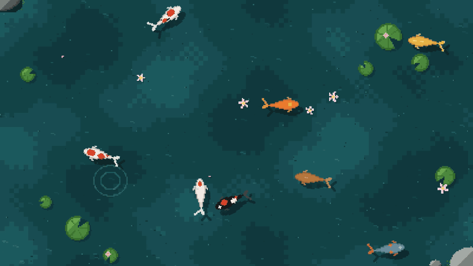

# Koi pond for Claude Desktop

An animated pixel-art koi pond that sits behind your Claude Desktop conversations.



- Eight koi swim their own loops. Their timing is worked out so that they cross paths but never swim stacked on top of each other.
- Raindrops land now and then and send out rings that fade away. They never land on a lily pad or a stone.
- Every so often a cherry blossom falls into the water, lands with a small ripple and drifts off the edge with the current.
- The colors match the scene: a dark teal theme with a koi-orange accent.

Once it is installed, the pond shows in every session. It is a single SVG with SMIL animations: no scripts, no network calls, nothing running in the background.

## Install

At the prompt of a Claude Code session in a terminal:

```
/plugin install koi-pond --marketplace synthentica/claude-koi-pond
```

Answer `y` to add the marketplace, then pick the user scope.

From a shell:

```bash
claude plugin install koi-pond --marketplace synthentica/claude-koi-pond
```

In the desktop app, where `/plugin` does not run: click **+** next to the prompt box, then **Plugins**. Choose **Add marketplace** with `synthentica/claude-koi-pond`, then **Add plugin**.

The backdrop is drawn by Claude Desktop and the mobile app; a session in a terminal has none.

## Notes

- Desktop animates the backdrop only while its background animation setting is on and macOS's **Reduce motion** is off. Otherwise it shows a still frame.
- Only the koi rotate, and they are drawn with soft edges. Rotating a group drawn with crisp pixel edges can stall Desktop's backdrop renderer, and every backdrop then stays frozen until you quit Claude (Cmd+Q) and reopen it.
- Desktop accepts a backdrop of up to 128 KiB, and the pond takes about 120 KiB of it.

## Changing the pond

`hooks/pond.js` is generated. Edit `tools/gen-pond.mjs`, then run:

```bash
node tools/gen-pond.mjs hooks/pond.js
```

The generator is seeded, so it draws the same pond every time. It prints the koi timing it settled on.

## License

MIT, except `hooks/make-colors.js` and `hooks/make-colors.d.ts`: these are the theme helper from Claude Code's plugin-authoring kit, included unchanged (see [LICENSE](LICENSE)).
